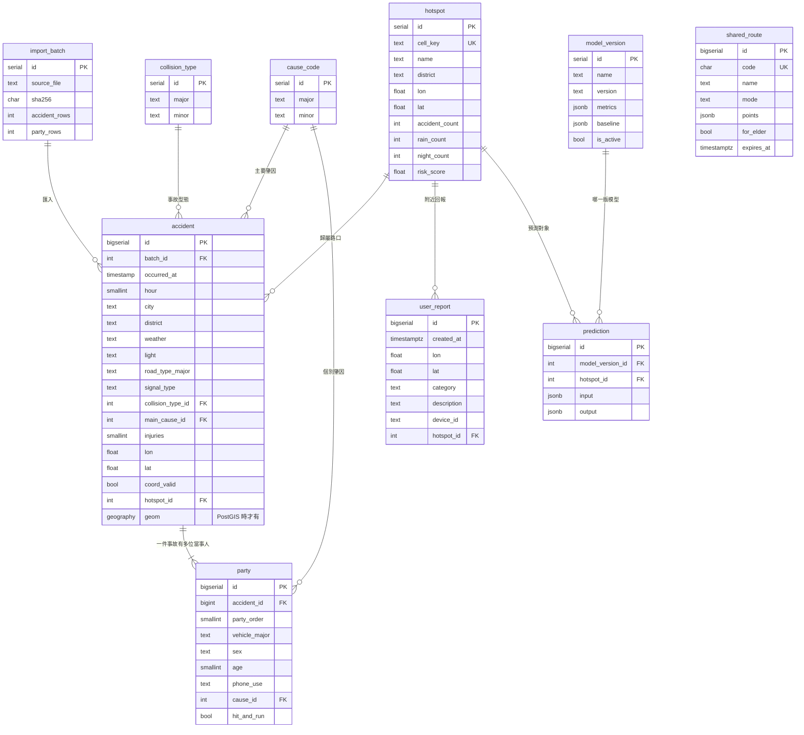

# 資料表關係（ER 圖）

> 由 `migrations/001_core.sql` 建立；PostGIS 版本另由 `002_spatial.postgis.sql` 加上 `geom` 產生欄位。
> GitHub 會直接把下面的 Mermaid 畫成圖。

## 設計重點

| 項目 | 說明 |
|---|---|
| 事故 vs 當事人 | 原始 CSV 一列是一位當事人；「當事者順位=1」開始一件新事故。事故層級欄位存在 `accident`，每一列都存在 `party`。 |
| 代碼正規化 | 肇因（大類＋子類）與事故型態另建 `cause_code`、`collision_type`，事故與當事人用外鍵參照。 |
| 路口（熱點） | `hotspot` 由 `scripts/build_hotspots.py` 依約 40 公尺格網彙整路口事故而成，`accident.hotspot_id` 回填歸屬。 |
| 可追溯 | `import_batch` 記錄每個原始檔與 SHA-256；`prediction.model_version_id` 讓每次 AI 預測都能回查模型版本。 |
| 家人模式 | `shared_route` 存子女分享給長輩的路線（6 碼代碼、30 天有效），長輩手機用代碼下載；獨立資料表，不與事故資料關聯。 |
| 座標品質 | `accident.coord_flag` 記錄座標不可用的原因（out_of_taiwan／shared_default／far_from_district）。 |
| 可移植 | 一般欄位 `lon/lat` 永遠存在；有 PostGIS 才加 `geom`（產生欄位＋GiST 索引），沒有時 API 改用 haversine 公式。 |
